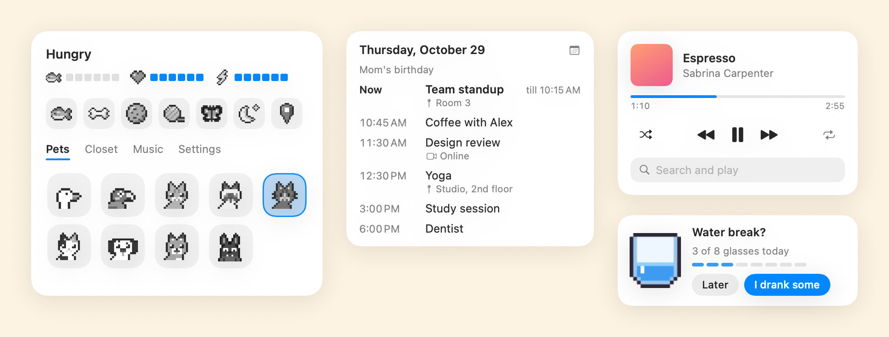

# Pocket Pet


A little pixel pet that lives on your Mac's desktop. It wanders around, naps when you're away, types along with you,
watches videos with popcorn and listens to your music in tiny headphones.


## ⬇️ Download

**[Get the latest Pocket Pet.dmg](https://github.com/d1v4nchik/Pocket-Pet/releases/latest)**: macOS 13 or newer,
Apple Silicon or Intel. Once installed, it updates itself.

## What It Is

Pocket Pet is a desktop companion in the spirit of Desktop Goose and Tamagotchi: one small pixel animal that shares your
screen with you and reacts to what you do.

- It **lives with you**: walks along the bottom of the screen (or every edge, with gravity off), naps when you step
  away, and visibly wakes up when you're back.
- It **keeps you company**: types along when you type, grabs popcorn when a video plays and puts on headphones when
  music is on.
- It **stays out of the way**: in fullscreen apps it climbs to the top edge and hangs out upside down; for fullscreen
  videos it sits in the black bar instead. Share your screen in a call and it asks whether to hide.
- It **looks after you**: it holds up a glass of water every so often (tap "I drank some" and it sips along and fills
  your glass for the day), nudges you before every calendar event, and rings a little bell when a message arrives.

## The Pets

| | Pet | Likes |
|---|---|---|
| 🪿 | Goose | Flying around, honking, cookies |
| 🦜 | Parrot | Saying hello, berries, showing off its tail |
| 🐈 | Ginger, Siamese, Tabby and Calico cats | Fish, yarn, chasing your cursor |
| 🐕 | Dalmatian | Bones, balls, zoomies |
| 🦊 | Fox | Berries, curling up for long naps |
| 🦇 | Bat | Hanging from the top of your screen, swooping |

Dress any of them up from the **Closet**: hats (including a Santa hat), glasses and neckwear.

## How It Plays

1. Open Pocket Pet. Your pet drops in and starts exploring.
2. Keep it happy: the three meters in its menu are **food**, **happiness** and **energy**.
3. Feed it a fish, a bone or a cookie, throw it a toy, let a butterfly out (no two look alike), or stroke it with the cursor.
4. Pick it up and throw it. With gravity on, cats float down on a little umbrella; the bat just flies back up.
5. Leave it alone for a while and it settles down for a nap.



## Controls

| | |
|---|---|
| Open the menu | Click the paw in the menu bar, or right-click the pet |
| Lost the paw, or hid the pet | Press **⌃⌥P**, or open Pocket Pet again from Spotlight |
| Today's calendar | Double-click the pet |
| Music controls and search | Click the pet while music plays |
| Pet it | Stroke it with the cursor |
| Throw it | Drag it and let go |
| Follow your cursor for a minute | The map pin in the menu |

## Installing

1. Download **Pocket.Pet.dmg** from the [latest release](https://github.com/d1v4nchik/Pocket-Pet/releases/latest) and
   open it.
2. Drag Pocket Pet onto **Applications**. Not an admin on your Mac? Use the Applications folder inside your home folder
   instead (Finder › Go › Home); it works from anywhere.
3. Open it. The first time, macOS says it can't check the app for malicious software, because it isn't from the App
   Store. Either open **System Settings › Privacy & Security**, scroll down and click **Open Anyway** (this can ask for an
   admin password), or, with no password, paste this into Terminal and open Pocket Pet again:
   ```bash
   xattr -dr com.apple.quarantine ~/Applications/Pocket\ Pet.app
   ```

## Connections

All optional, all in the menu's **Settings › Connections**.

| | Works with | Needs |
|---|---|---|
| 📅 Calendar | Any mix of: a calendar's private link (Google, Outlook, iCloud), every calendar on your Mac, and Google sign-in, all shown together | Nothing, or Calendar access |
| 🎵 Music | Spotify and Apple Music straight away, nothing to sign in to. Any other player (YouTube Music, Tidal, VLC, a music site in your browser) through the media keys. Connecting a Spotify account is optional: it adds the queue and search | Permission to control the app; Accessibility for other players |
| 🔔 Notification bell | New messages in browser tabs (Safari and every Chrome-based browser), and every app's notifications | Permission to control the browser; Accessibility for every app |

macOS only lets an administrator switch on Accessibility, so on a Mac you aren't an admin of, that step asks for an admin
password.

**Accessibility is on but the bell or media keys don't work?** That switch belongs to an older copy of Pocket Pet. In
System Settings › Privacy & Security › Accessibility, select Pocket Pet, click **−**, then add it again with **+**. From
3.3 on, updates keep the permission.

## Privacy

Nothing is collected or sent anywhere. The only things that go over the internet are your calendar (to Google or
wherever its link points), Spotify (when you connect it), album covers for Apple Music songs, and the update check here
on GitHub. Pocket Pet knows *that* you're typing, never *what*. See [SECURITY.md](SECURITY.md) for the details.

## Building From Source

**Requirements:** macOS 13+ and Apple's command line tools (`xcode-select --install`).

```bash
git clone https://github.com/d1v4nchik/Pocket-Pet.git
cd Pocket-Pet
./build.sh && open "Pocket Pet.app"   # build and run
./package.sh                          # make dist/Pocket Pet.dmg (Apple Silicon and Intel)
```

Publishing an update (maintainer only) is `./release.sh <version> "what's new"`. Updates are signed with a key that stays
on the maintainer's Mac, and Pocket Pet refuses any update without that signature. The app itself is signed with a
certificate of its own (made once with `./build.sh --new-signing-identity`), so macOS keeps its permissions through
updates.

## Contributing

Bug reports, ideas, new pets and pixel art are all welcome: see [CONTRIBUTING.md](CONTRIBUTING.md) and the
[Code of Conduct](CODE_OF_CONDUCT.md). Please report security issues privately as described in [SECURITY.md](SECURITY.md).

## License

Copyright (C) 2026 d1v4nchik

Pocket Pet is free software: you can redistribute it and/or modify it under the terms of the
[GNU General Public License v3.0](LICENSE) as published by the Free Software Foundation. It is distributed in the hope
that it will be useful, but WITHOUT ANY WARRANTY; without even the implied warranty of MERCHANTABILITY or FITNESS FOR A
PARTICULAR PURPOSE.

## Disclaimer

Pocket Pet is an independent fan-made project. It is not affiliated with or endorsed by Apple, Spotify, Google,
Microsoft or any of the other companies whose products it works with; their names are trademarks of their respective
owners.
