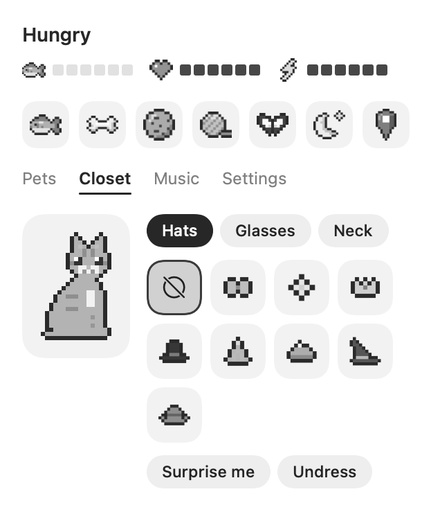
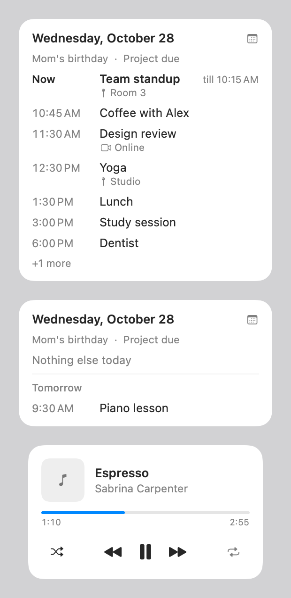

<p align="center"></p>

<h1 align="center">Pocket Pet</h1>

<p align="center">A little pixel pet that lives on your Mac's desktop.<br>
<a href="https://github.com/d1v4nchik/pocket-pet/releases/latest"><b>Download Pocket Pet</b></a> · macOS 13 or newer · Apple Silicon and Intel</p>

<p align="center"></p>

## What it does

- **Lives with you.** It wanders around, naps when you step away and wakes up when you're back.
- **Keeps you company.** It types along when you type, watches videos with popcorn and listens to your music in headphones.
- **Plays.** Feed it a fish, a bone or a cookie, throw it a toy, let a butterfly out, stroke it with the cursor, or pick it up and throw it.
- **Seven pets** (a goose, four cats, a dalmatian and a bat) **and a closet** of hats, glasses and neckwear.
- **Gravity on or off.** It walks the floor, or every edge of the screen. In fullscreen apps it climbs up and hangs out upside down along the top, out of your way (for fullscreen videos it sits in the black bar instead).
- **Your day.** Double-click it for today's calendar, with rooms, plus a nudge before each event.
- **Your music.** Click it while Spotify plays for controls; the Music tab shows what's up next and lets you queue songs.
- **A notification bell.** It rings when something new arrives; click the bell to go straight there.
- **Easy on your battery:** about half a percent of CPU while it rests.
- **Updates itself.** New versions show up in the app; one click installs them.

<p align="center">
  
  
</p>

## Install

1. Download **Pocket Pet.dmg** from the [latest release](https://github.com/d1v4nchik/pocket-pet/releases/latest) and open it.
2. Drag Pocket Pet onto **Applications**.
   Not an admin on your Mac? Use the Applications folder inside your home folder instead (Finder → Go → Home); it works from anywhere.
3. Open it. The first time, macOS may say it can't check the app for malicious software, because it isn't from the App Store. Either
   - open **System Settings → Privacy & Security**, scroll down and click **Open Anyway** (this can ask for an admin password), or
   - with no password: open Terminal, paste the line below (change the path if you put it elsewhere) and open Pocket Pet again.
     ```
     xattr -dr com.apple.quarantine ~/Applications/Pocket\ Pet.app
     ```

## Using it

| | |
|---|---|
| Open the menu | Click the paw in the menu bar, or right-click the pet |
| Can't find the paw, or hid the pet | Press **⌃⌥P**, or open Pocket Pet again from Spotlight |
| Today's calendar | Double-click the pet |
| Music controls | Click the pet while Spotify plays |
| Pet it | Stroke it with the cursor |
| Throw it | Drag it and let go |

Everything else (gravity, size, the calendar, the bell, open at login) is in the menu's **Settings**.

## Permissions

All optional. macOS asks the first time a feature needs one.

| Permission | What it's for |
|---|---|
| Control your browser | The bell reads tab titles like "(2) Discord" and opens that tab for you |
| Control Spotify | Showing and controlling what's playing |
| Accessibility | The bell ringing for every app's notifications (it only reads who a notification is from) |
| Calendars | Reading your Mac's calendars, if you connect them that way |

Nothing is collected or sent anywhere. The only things that go over the internet are your calendar and Spotify (to Google and Spotify, when you connect them) and the check for new versions here on GitHub.

## Building it yourself

Needs Apple's command line tools (`xcode-select --install`).

```sh
./build.sh && open "Pocket Pet.app"      # build and run
./package.sh                             # make dist/Pocket Pet.dmg for Apple Silicon and Intel
./release.sh 3.2 "What's new"            # publish an update to everyone (maintainer only)
```

Updates are signed with a key that stays on the maintainer's Mac (`~/.pocketpet/update-key`), and Pocket Pet only installs updates carrying that signature.
